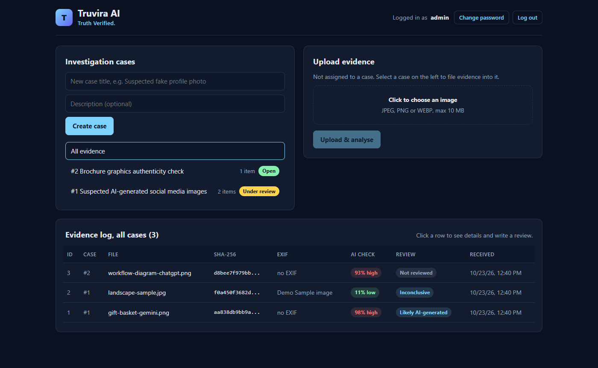
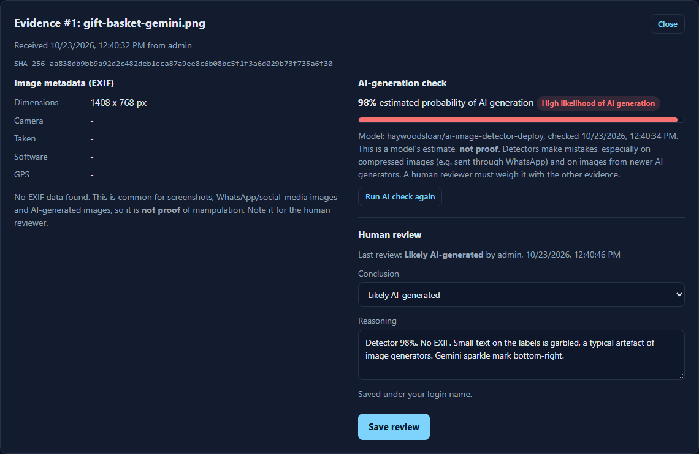
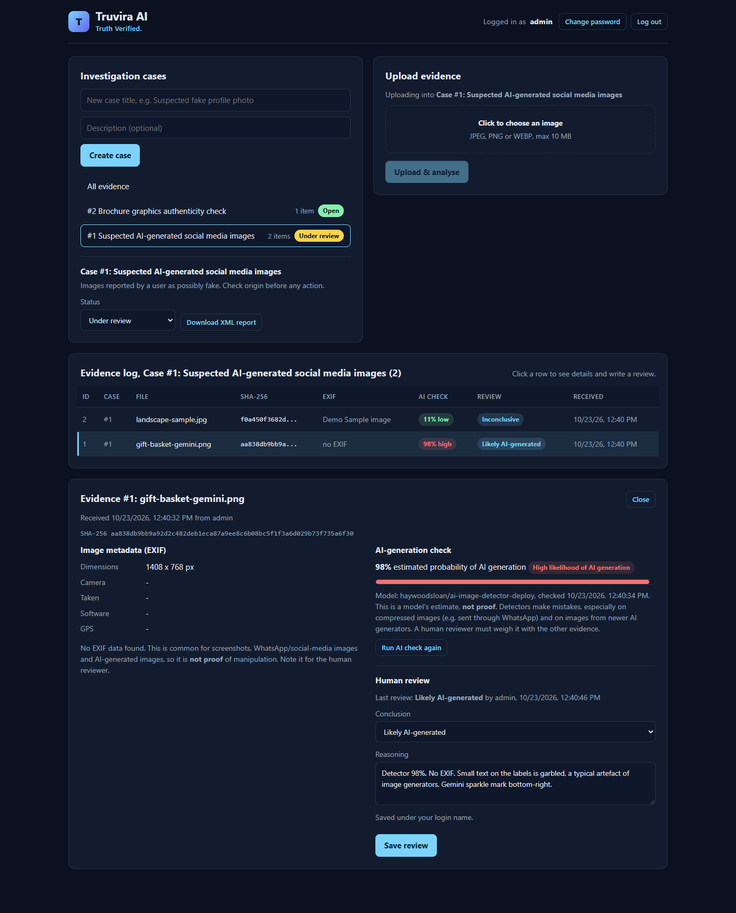
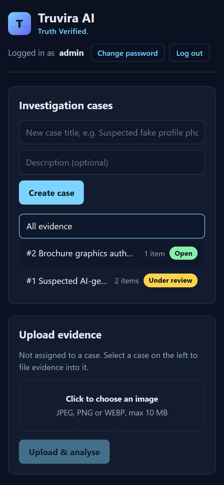
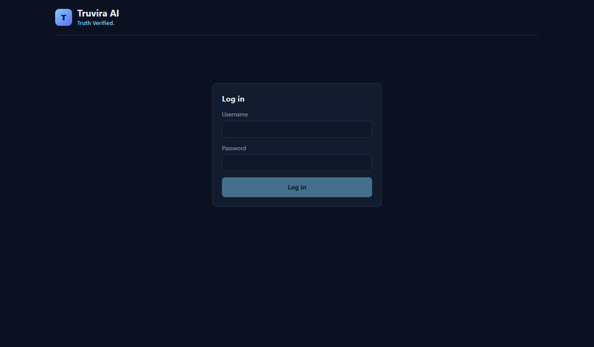
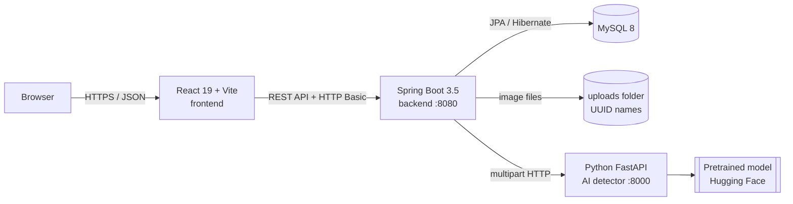

# Truvira AI: *Truth Verified.*

**AI-assisted digital image forensics.** Upload a suspicious image and Truvira preserves it as evidence
(SHA-256 hash, timestamp, uploader), extracts its EXIF metadata, estimates how likely it is to be
AI-generated, and lets a **human reviewer** record a conclusion and export a forensic XML report.

> **Truvira is a decision-support tool, not a judge.** It never declares an image definitively fake.
> AI scores are probabilities with known limitations, and the final conclusion is always a person's.


---

## Screenshots

*All screenshots use a demo database with sample images, not real case data.*

**Dashboard:** investigation cases, upload, and the evidence log with AI scores and review status.



**Evidence detail:** metadata on the left; the AI estimate and the human review on the right.



<table>
  <tr>
    <td width="62%"><b>Case view</b><br></td>
    <td><b>Phone layout</b><br></td>
  </tr>
</table>

**Login**



---

## Features

| | Feature | Details |
|---|---|---|
| 🔒 | **Evidence integrity** | SHA-256 computed while the file is saved; files stored under random UUID names; duplicates detectable by hash |
| 🧾 | **EXIF metadata** | Camera make/model, software, date taken, GPS and dimensions (JPEG, PNG, WEBP) via `metadata-extractor` |
| 📁 | **Investigation cases** | Group evidence into cases with status *Open → Under review → Closed*; closed cases are frozen |
| 🤖 | **AI-generation check** | Pretrained detector in a separate Python service; if it is offline, uploads still work (`UNAVAILABLE` fallback, no invented score) |
| 🧑‍⚖️ | **Human review** | Conclusion (*likely authentic / AI-generated / manipulated / inconclusive*) + reasoning, signed with the logged-in user |
| 📄 | **XML forensic report** | One file per case with hashes, metadata, AI scores, reviews and a limitations disclaimer (JAXB) |
| 👤 | **Login** | Spring Security (HTTP Basic, stateless), BCrypt password hashes, change-password |
| ✅ | **Tests** | 12 JUnit 5 + Mockito unit tests for the service layer |

---

## Architecture



The backend is layered: **Controller** (HTTP) → **Service** (business rules) → **Repository** (database).

**What happens on upload:**
1. React sends the file (and optional case id) to `POST /api/evidence/upload` with the login header.
2. `EvidenceService` checks the type (JPEG/PNG/WEBP, max 10 MB) and that the case is not closed.
3. The file is streamed to disk under a UUID name **while** SHA-256 is computed.
4. `MetadataService` reads EXIF from the saved copy; `DetectorClient` asks the Python service for an AI score.
5. The record is saved to MySQL and returned as JSON; a reviewer can then add a conclusion.

---

## Tech stack

| Layer | Technologies |
|---|---|
| Frontend | React 19, Vite 8, plain CSS (responsive) |
| Backend | Java 17+, Spring Boot 3.5 (Web, Data JPA, Security, Validation), Hibernate, JAXB, metadata-extractor |
| AI service | Python 3.13, FastAPI, Uvicorn, Hugging Face Transformers, PyTorch (CPU) |
| Database | MySQL 8 (H2 in-memory for testing) |
| Testing | JUnit 5, Mockito |
| Tools | Maven, npm, Git/GitHub, IntelliJ IDEA, Postman |

AI model: [`haywoodsloan/ai-image-detector-deploy`](https://huggingface.co/haywoodsloan/ai-image-detector-deploy)
(SwinV2, Apache-2.0), swappable with the `TRUVIRA_MODEL` environment variable.

---

## Quick start with Docker (easiest)

Needs only **Docker** (Docker Desktop on Windows/Mac, or Docker Engine on Linux).

```bash
git clone https://github.com/Allen2255/truvira-ai.git
cd truvira-ai
cp .env.example .env        # then open .env and set DB_PASSWORD and MYSQL_ROOT_PASSWORD
docker compose up -d --build
```
Open **http://localhost** (or the `HTTP_PORT` you set in `.env`).

- Log in as **`admin`**. The password is `TRUVIRA_ADMIN_PASSWORD` from `.env`, or, if you left it
  empty, a random one shown once in `docker compose logs backend`.
- The first start takes a while: images build, and the AI model (~745 MB) downloads in the background.
  Until it is ready, uploads still work and show *"AI check not available"* with a **Retry** button.
- Stop with `docker compose down`. Your data is kept in Docker volumes. (Never add `-v`: that deletes them.)

Four containers start: **web** (Caddy, the only one with open ports), **backend**, **ai-service** and
**mysql**, connected by a private Docker network.

## Getting started (local, without Docker)

### Prerequisites
Java 17+, Maven, Node.js 20+, MySQL 8, and (optional, for the AI check) Python 3.13.

### 1. Database
In MySQL, create the database and a user (choose your own password):
```sql
CREATE DATABASE truvira;
CREATE USER 'truvira_user'@'localhost' IDENTIFIED BY 'choose-a-strong-password';
GRANT ALL PRIVILEGES ON truvira.* TO 'truvira_user'@'localhost';
```

### 2. Backend
```bash
cd backend
cp src/main/resources/application.example.properties src/main/resources/application.properties
# edit application.properties: set spring.datasource.password
mvn spring-boot:run          # http://localhost:8080
```
Tables are created automatically. On first start, user **`admin`** is created with a random password
printed **once** in the console (or set `truvira.admin.password` beforehand). Change it in the app via
**Change password**.

No MySQL? Run with an in-memory database: `mvn spring-boot:run -Dspring-boot.run.profiles=h2`

### 3. Frontend
```bash
cd frontend
npm install
npm run dev                  # http://localhost:5173
```

### 4. AI detector (optional)
```bash
cd ai-service
python -m venv .venv
.venv/Scripts/python -m pip install torch --index-url https://download.pytorch.org/whl/cpu   # Windows path
.venv/Scripts/python -m pip install -r requirements.txt
.venv/Scripts/python -m uvicorn app:app --port 8000
```
The model (~745 MB) downloads on the first start. Without this service, uploads still work and show
*"AI check not available"*.

### Configuration
| Setting | Where | Default |
|---|---|---|
| `spring.datasource.*` | `application.properties` | MySQL `truvira` on localhost |
| `truvira.upload-dir` | `application.properties` | `uploads` |
| `truvira.detector.url` | `application.properties` / env | `http://localhost:8000` |
| `truvira.frontend-origin` (CORS) | `application.properties` / env | `http://localhost:5173` |
| `truvira.admin.password` | `application.properties` / env | random, printed once |
| `VITE_API_URL` | frontend environment | `http://localhost:8080/api` |

---

## API

All `/api/**` endpoints require HTTP Basic login. Errors are always `{"error": "..."}` (400 bad input, 401 login, 404 not found).

| Method | Endpoint | Purpose |
|---|---|---|
| `GET` | `/api/auth/me` | Who is logged in |
| `PUT` | `/api/auth/password` | Change own password `{currentPassword, newPassword}` |
| `POST` | `/api/evidence/upload` | Upload image (multipart `file`, optional `caseId`) → 201 |
| `GET` | `/api/evidence` | All evidence, newest first |
| `GET` | `/api/evidence/{id}` | One evidence record |
| `POST` | `/api/evidence/{id}/detect` | Re-run the AI check |
| `PUT` | `/api/evidence/{id}/review` | Save human review `{conclusion, note}` |
| `POST` | `/api/cases` | Create case `{title, description}` → 201 |
| `GET` | `/api/cases` | Cases with evidence counts |
| `GET` | `/api/cases/{id}` | One case |
| `PATCH` | `/api/cases/{id}/status` | `{status: OPEN \| UNDER_REVIEW \| CLOSED}` |
| `GET` | `/api/cases/{id}/evidence` | Evidence in a case |
| `GET` | `/api/cases/{id}/report` | Download the XML forensic report |

### Sample XML report (excerpt)
```xml
<forensicReport generatedAt="2026-10-23T12:42:36" tool="Truvira AI">
    <disclaimer>AI detection scores are probabilistic estimates from a pretrained model and can be wrong,
      especially for compressed images or new generators. Missing EXIF metadata is not proof of
      manipulation. Conclusions in this report are the human reviewer's judgement.</disclaimer>
    <case id="1">
        <title>Suspected AI-generated social media images</title>
        <status>UNDER_REVIEW</status>
    </case>
    <evidenceItems>
        <evidence id="2">
            <originalFileName>landscape-sample.jpg</originalFileName>
            <sha256>f0a450f3682d66e77cb8da45bf79191a9ac9fbb3985a221c8df6f7c004be5c73</sha256>
            <uploadedBy>admin</uploadedBy>
            <metadata exifFound="true">
                <cameraMake>Demo</cameraMake>
                <software>Truvira demo generator</software>
            </metadata>
            <aiDetection status="COMPLETED">
                <score>0.1083</score>
                <model>haywoodsloan/ai-image-detector-deploy</model>
            </aiDetection>
            <humanReview>
                <conclusion>INCONCLUSIVE</conclusion>
                <note>Detector only 11%, but EXIF says Make=Demo / Software=Truvira demo generator:
                  not a camera photo. Low AI score does not prove authenticity.</note>
                <reviewer>admin</reviewer>
            </humanReview>
        </evidence>
    </evidenceItems>
</forensicReport>
```

---

## Tests
```bash
cd backend
mvn test
```
12 unit tests (JUnit 5 + Mockito) cover: rejecting non-images and empty files, correct SHA-256 and UUID
storage, the `UNAVAILABLE` fallback, closed-case and unknown-case rules (with no orphan files left on
disk), review rules, case creation, and password changes (BCrypt hash stored, wrong current password refused).

---

## Project structure
```
truvira-ai/
├── backend/      Spring Boot (controller, service, repository, model, dto, report, security) + tests
├── frontend/     React app (src/api.js, src/App.jsx, src/components/)
├── ai-service/   Python FastAPI detector (app.py, requirements.txt)
├── docs/         README screenshots
├── docker-compose.yml   all 4 containers, volumes, health checks
└── .env.example         settings/password template for Docker (copy to .env)
```

---

## Limitations and responsible use
- **AI detectors make mistakes.** In our own tests a Gemini image scored 98%, but the same image shrunk
  to 400 px and saved as low-quality JPEG dropped to ~30%. Compression and new generators reduce accuracy.
- The detector looks for **generative-AI** traces; a computer-drawn or edited image can still score low
  (see the demo landscape above, 11%).
- **Missing EXIF is not evidence of manipulation:** messaging apps, screenshots and generators remove it, and
  EXIF can be edited by anyone.
- GPS data in images is personal data. Restrict access and only share reports with authorised people.
- Local setup uses HTTP; any online deployment **must use HTTPS** because login credentials travel with every request.

## Roadmap
- ~~Docker Compose setup~~ ✅ done
- Deployment on AWS EC2, evidence storage in S3 (Object Lock), HTTPS via a free DuckDNS domain
- Swagger/OpenAPI docs, Spring Boot Actuator, scheduled re-checks of unavailable AI results
- React Router pages and frontend tests

---

*Built as a learning project by [Allen2255](https://github.com/Allen2255).*
